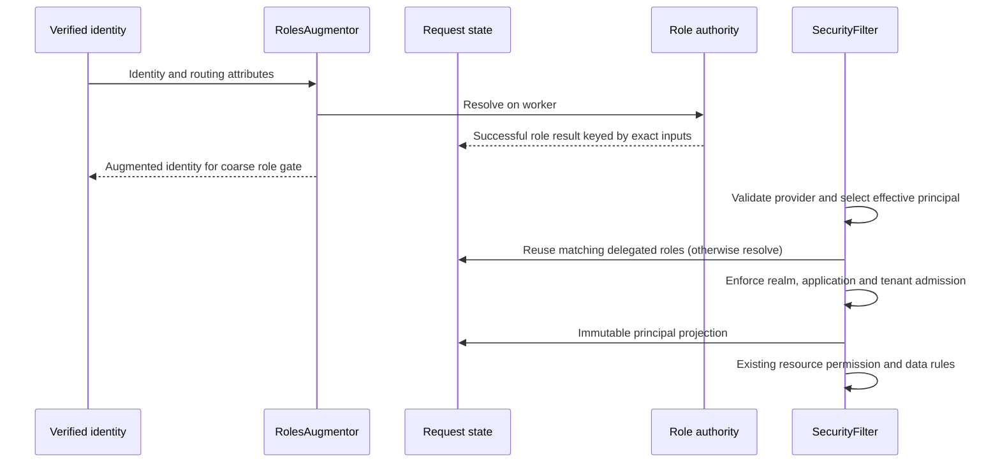

# Quantum Security Runtime

`quantum-security-runtime` contains the endpoint-free HTTP security runtime:
authorization filters, realm resolution, role augmentation, model mapping,
and field-policy response handling.

Server REST modules select this artifact when they need Quantum request
security. Client applications using generated SDKs should not depend on it.

This artifact does not expose REST endpoints.

## Request lifecycle (1.4.3-SNAPSHOT)

`RolesAugmentor` dispatches repository and membership work through Quarkus's
blocking authentication context. It obtains the request from the authentication
attributes, so the JAX-RS request context need not exist yet. Existing two-argument
augmentation and non-HTTP callers remain supported.

For delegated application sessions, `RequestAuthorizationState` stores successful
role resolutions on the Vert.x `RoutingContext`. `RolesAugmentor` and
`SecurityFilter` reuse a result only for identical issuer, subject, user ID,
effective realm, application ID and token roles. Results are defensively copied;
exceptions are not cached. A later request re-reads role authority. This gives
one request a stable role observation, not immediate mid-request revocation.
Embedded `IdentityRoleResolver` implementations remain uncached because their
custom credential inputs do not yet have a complete versioned cache contract.



`ResolvedAuthorizationContext` is a package-private immutable projection after
principal admission. It is not a permission decision, a public extension SPI,
or a replacement for `PrincipalContext` / `RuleContext`. Custom properties,
policy provenance and full coarse/fine role parity remain outside this slice.
The legacy augmented `user` role behavior is retained. No public signatures,
wire fields or storage shapes change.

With `quantum.auth.trust-token-claims=true`, augmentation and authenticated JWT
migration realm selection avoid local `CredentialRepo` lookups. Migration checks
still run: an explicit `X-Realm` keeps existing precedence; otherwise service
tokens use the system realm, sessions use the configured session realm or signed
realm. Missing required signed realm fails closed. Realm selection never grants
realm access; the authorization filter still admits the request separately.

## Verification

Run `mvn -pl quantum-security-runtime,quantum-oauth-server -am test` from the
repository root, plus the released-provider probe documented under
`compatibility/auth-provider`. `AuthorizationLifecycleHttpTest` uses real signed
JWTs, HTTP routing, augmentation and REST admission with mocked provider,
directory, membership and migration services. It checks worker dispatch, one
matching role read per request, async snapshot access, denied app/tenant access
and revocation on the next request. The PEM files under test resources are
public disposable fixtures only. These tests do not prove production directory
availability, full rule-engine integration, OIDC or refresh rotation.

## Optional session realm selection policy

Applications may implement `com.e2eq.framework.security.session.SessionSelectionPolicy`
as a CDI bean and explicitly select its stable `id()` and exact `version()`:

```properties
quantum.security.session.selection-policy=fixed-workspace
quantum.security.session.selection-policy-version=1
```

Both settings omitted preserves the existing header/configuration/token behavior,
even when policy beans are installed. An explicit missing, duplicate or mismatched
selection fails startup with `SessionSelectionException` and a stable code. There
is no CDI-priority winner or fallback to default after a policy failure.

A policy receives immutable identity metadata, the untrusted requested realm,
configured realm and application id. It returns only `Selection(realm)`: null
realm means retain the principal's realm; a null result or blank realm is invalid.
It cannot set roles, tenant, application, identity or grants. Policies must be
pure and deterministic with no I/O. Only authenticated user identities invoke
them; service and anonymous requests retain their existing behavior. Matching
inputs reuse the proposal across augmentation, migration checks and REST admission
within one request. The framework still validates the proposed realm and enforces
application and tenant admission. Policy code is trusted installed application
code, not a sandbox for untrusted scripts.

```java
@jakarta.enterprise.context.ApplicationScoped
public class FixedWorkspace implements SessionSelectionPolicy {
    public String id() { return "fixed-workspace"; }
    public String version() { return "1"; }
    public Selection select(Input input) {
        return new Selection(input.configuredRealm());
    }
}
```

A workspace-selecting application can instead propose `input.requestedRealm()`
when present, otherwise `input.configuredRealm()`. The tests
`FixedWorkspaceHttpTest` and `RequestedWorkspaceHttpTest` exercise these two
policies with the same runtime. They retain the baseline HTTP denial tests and
prove that even an `editor` role cannot admit an unregistered realm. These are
application-policy fixtures, not deployed reference applications.

This additive SPI is limited to realm proposals. It is separate from internal
`ResolvedAuthorizationContext`; it does not establish full authority provenance,
new role sources, session lifetime policy, OIDC or refresh replay protection.

## Cross-application identity and token stability coverage

`CrossApplicationAHttpTest` and `CrossApplicationBHttpTest` boot separately with
application IDs `app-a` and `app-b`. Both send the same byte-for-byte signed
`shared-identity-test.jwt` fixture. It uses a disposable test key and deliberately
fixed dates (not production lifetime guidance). SHA-256 of the trimmed fixture:
`54106a6e665ddb5876c9972a55b179a033f044775538fc5146ccdd610c945f97`.
Both applications explicitly trust its `shared-test-api` audience. This is a
shared-audience test configuration, not permission to forward any application's
token to any other service or weaken issuer/audience checks.

| Boundary | Executable assertion |
| --- | --- |
| Shared identity | The same subject, signed `azp` and token bytes survive both application configurations; effective application differs only in request context. No login, refresh or token issuance occurs in either application. |
| Application authorization | Revoking only A's application grant gives A a 403 while B remains admitted. Restoring the grant works with the original token. |
| Role authorization | Issuer-client `admin` does not become target-app admin. Removing authoritative reader roles denies access even though the token still contains `app-reader`; restoring roles works without token replacement. |
| Authentication | Wrong issuer, audience, signature and expired tokens produce 401 before provider/membership authorization calls. |
| Remote identity boundary | Neither application reads local credentials. |

These tests cover foreign-application sessions (`azp=identity-client` with
effective app A/B), not same-application token-role revocation. They use real
HTTP, JWT verification, augmentation and admission with
mocked directory/membership/provider seams. Resource fixtures intentionally use
`bypassDataScoping` to isolate admission and Jakarta role checks; they do not
prove the full rule/repository policy matrix. Application boots are sequential,
not two simultaneous servers or browser sessions.

### JWT review: issuing and receiving application behavior

The same profiles also exercise `app-a-identity-test.jwt`, a disposable signed
fixture with `azp=app-a`. Its trimmed SHA-256 is
`8e9294e43c77174a92a45dd08d483f30871dd0428504808d8a0f5decc5176393`.
The existing fixture remains unchanged. This adds the normal origin-to-receiver
case to the third-application fixture above.

| Same valid app-A JWT, same realm | App A (issuing application) | App B (receiving application) |
| --- | --- | --- |
| Signed admin, current assignment has reader only | Signed admin remains effective | Admin denied; reader admitted |
| Current assignment roles removed | Signed reader remains effective | Reader denied on next request |
| Current assignment application grants removed | Existing signed-origin admission remains | Application admission denied |

These are compatibility characterization tests, not assertions that immediate
origin revocation is implemented. `RolesAugmentor.applicationSessionRoles` and
`SecurityFilter.buildDelegatedClaimsContext` retain signed roles for an unchanged
application/realm. `requireSessionApplicationAdmitted` rechecks the foreign-app
case. The mocked provider continues to accept the token: an actual provider may
reject it earlier through its own validation/revocation contract. Consequently,
next-request role/grant revocation is proven here only for the receiving app.
Do not silently change the origin behavior: existing apps may rely on signed
roles without a request-time membership authority. A future opt-in current-role
policy must define authority availability, missing memberships, global roles and
both coarse/fine authorization before activation; no new JWT claims are needed.

For a JWT-based application, review its existing login/refresh provider, audience
admission and application-session configuration first. OAuth browser login,
OIDC nonce/PKCE and issuer cookies are separate optional protocol work, not
prerequisites for these bearer-JWT paths. These tests do not prove frontend token
handoff, production provider revocation, two simultaneous servers, or a browser
login flow. Test the actual frontend handoff independently when it is in scope.

Keep tokens simple: retain stable issuer/subject/audience and supported identity
claims; keep mutable app grants and effective realm/tenant/roles in authoritative
services and request context. Do not rewrite `azp`, add per-app token dialects,
copy authorization graphs into tokens, or mint a replacement token merely to
switch request context. When audiences differ, use the issuer's supported flow
for the appropriate audience; sharing sign-in does not require sharing an access
token across incompatible audiences.

Request migration checks reuse `SystemRealmOwnership`: embedded deployments check
the system schema; remote deployments leave that schema to the control-plane owner.
Application schema checks still fail closed in either mode. This is independent of
authentication and admission and does not grant access to a remote system database.
