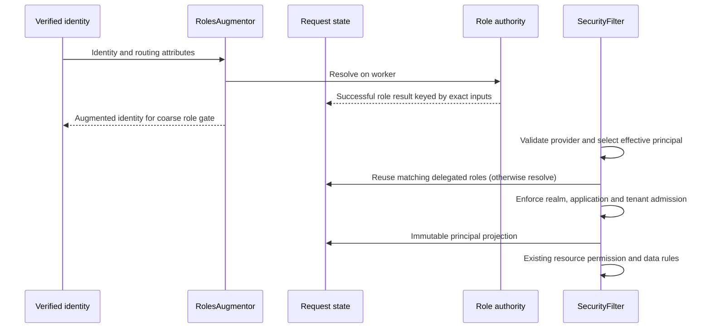

# Quantum Security Runtime

`quantum-security-runtime` contains the endpoint-free HTTP security runtime:
authorization filters, realm resolution, role augmentation, model mapping,
and field-policy response handling.

Server REST modules select this artifact when they need Quantum request
security. Client applications using generated SDKs should not depend on it.

This artifact does not expose REST endpoints.

## Request lifecycle (1.4.3-SNAPSHOT)

`RolesAugmentor` dispatches repository and membership work through Quarkus's
blocking authentication context. It obtains the request from the authentication
attributes, so the JAX-RS request context need not exist yet. Existing two-argument
augmentation and non-HTTP callers remain supported.

For delegated application sessions, `RequestAuthorizationState` stores successful
role resolutions on the Vert.x `RoutingContext`. `RolesAugmentor` and
`SecurityFilter` reuse a result only for identical issuer, subject, user ID,
effective realm, application ID and token roles. Results are defensively copied;
exceptions are not cached. A later request re-reads role authority. This gives
one request a stable role observation, not immediate mid-request revocation.
Embedded `IdentityRoleResolver` implementations remain uncached because their
custom credential inputs do not yet have a complete versioned cache contract.



`ResolvedAuthorizationContext` is a package-private immutable projection after
principal admission. It is not a permission decision, a public extension SPI,
or a replacement for `PrincipalContext` / `RuleContext`. Custom properties,
policy provenance and full coarse/fine role parity remain outside this slice.
The legacy augmented `user` role behavior is retained. No public signatures,
wire fields or storage shapes change.

With `quantum.auth.trust-token-claims=true`, augmentation and authenticated JWT
migration realm selection avoid local `CredentialRepo` lookups. Migration checks
still run: an explicit `X-Realm` keeps existing precedence; otherwise service
tokens use the system realm, sessions use the configured session realm or signed
realm. Missing required signed realm fails closed. Realm selection never grants
realm access; the authorization filter still admits the request separately.

## Verification

Run `mvn -pl quantum-security-runtime,quantum-oauth-server -am test` from the
repository root, plus the released-provider probe documented under
`compatibility/auth-provider`. `AuthorizationLifecycleHttpTest` uses real signed
JWTs, HTTP routing, augmentation and REST admission with mocked provider,
directory, membership and migration services. It checks worker dispatch, one
matching role read per request, async snapshot access, denied app/tenant access
and revocation on the next request. The PEM files under test resources are
public disposable fixtures only. These tests do not prove production directory
availability, full rule-engine integration, OIDC or refresh rotation.

## Optional session realm selection policy

Applications may implement `com.e2eq.framework.security.session.SessionSelectionPolicy`
as a CDI bean and explicitly select its stable `id()` and exact `version()`:

```properties
quantum.security.session.selection-policy=fixed-workspace
quantum.security.session.selection-policy-version=1
```

Both settings omitted preserves the existing header/configuration/token behavior,
even when policy beans are installed. An explicit missing, duplicate or mismatched
selection fails startup with `SessionSelectionException` and a stable code. There
is no CDI-priority winner or fallback to default after a policy failure.

A policy receives immutable identity metadata, the untrusted requested realm,
configured realm and application id. It returns only `Selection(realm)`: null
realm means retain the principal's realm; a null result or blank realm is invalid.
It cannot set roles, tenant, application, identity or grants. Policies must be
pure and deterministic with no I/O. Only authenticated user identities invoke
them; service and anonymous requests retain their existing behavior. Matching
inputs reuse the proposal across augmentation, migration checks and REST admission
within one request. The framework still validates the proposed realm and enforces
application and tenant admission. Policy code is trusted installed application
code, not a sandbox for untrusted scripts.

```java
@jakarta.enterprise.context.ApplicationScoped
public class FixedWorkspace implements SessionSelectionPolicy {
    public String id() { return "fixed-workspace"; }
    public String version() { return "1"; }
    public Selection select(Input input) {
        return new Selection(input.configuredRealm());
    }
}
```

A workspace-selecting application can instead propose `input.requestedRealm()`
when present, otherwise `input.configuredRealm()`. The tests
`FixedWorkspaceHttpTest` and `RequestedWorkspaceHttpTest` exercise these two
policies with the same runtime. They retain the baseline HTTP denial tests and
prove that even an `editor` role cannot admit an unregistered realm. These are
application-policy fixtures, not deployed reference applications.

This additive SPI is limited to realm proposals. It is separate from internal
`ResolvedAuthorizationContext`; it does not establish full authority provenance,
new role sources, session lifetime policy, OIDC or refresh replay protection.
